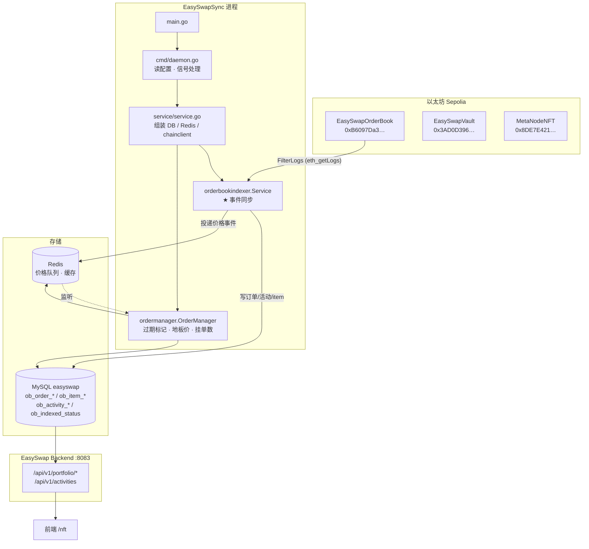
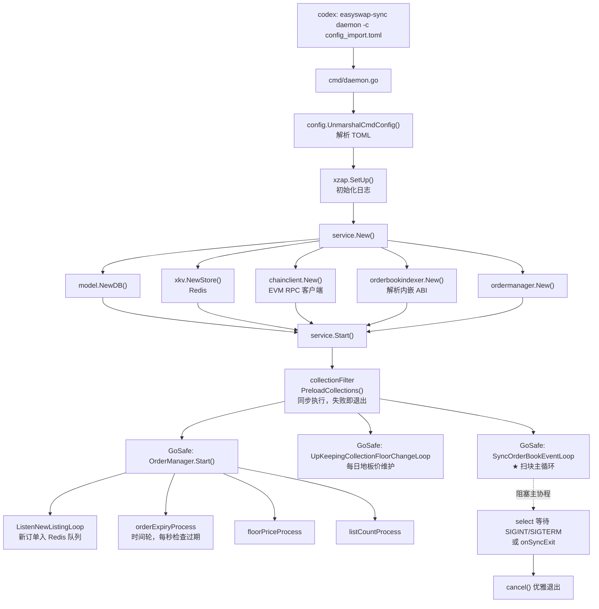
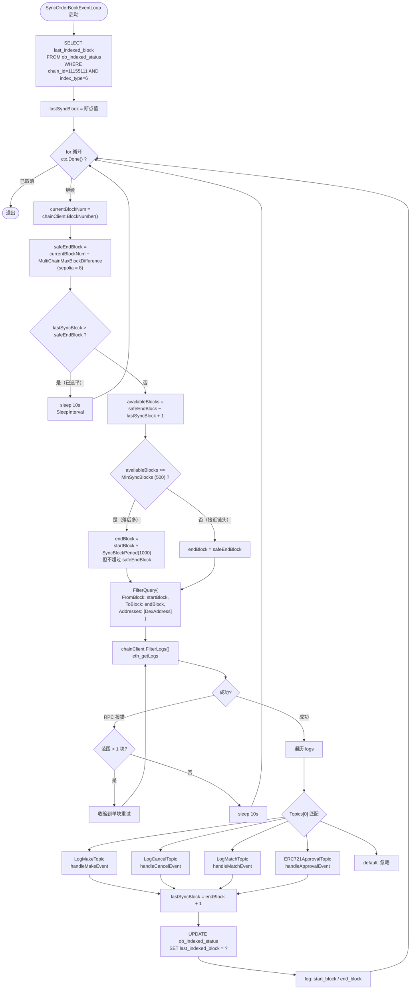
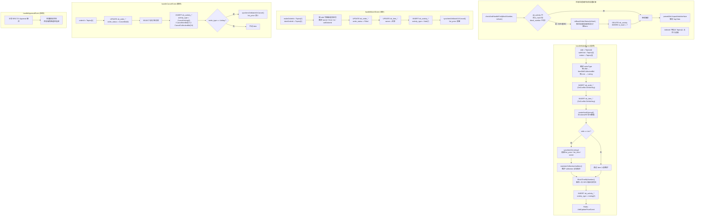
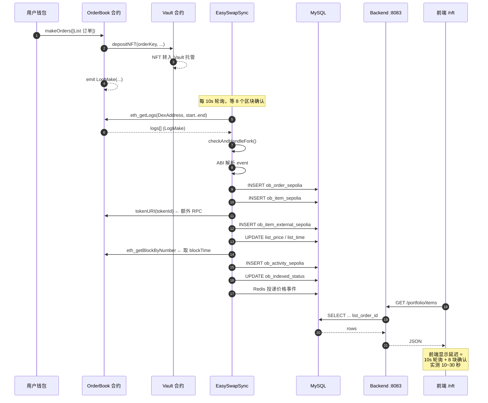
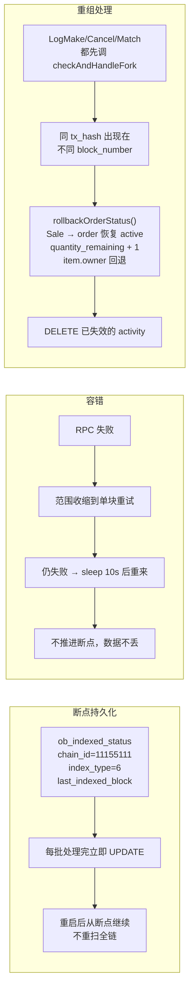
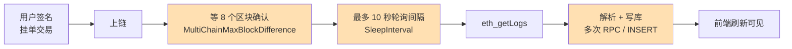

# EasySwapSync 链上事件同步流程

> 代码位置：`EasySwapSync/service/orderbookindexer/service.go`
> 独立进程，systemd unit `easyswap-sync`，配置 `/opt/easyswap-sync/config_import.toml`

---

## 一、整体架构

---

## 二、启动与并发模型

---

## 三、扫块主循环（核心）

**参数含义**

| 常量 | 值 | 作用 |
|---|---|---|
| `SleepInterval` | 10s | 追平链头后的轮询间隔 |
| `MultiChainMaxBlockDifference["sepolia"]` | 8 | 等 8 个区块确认，防重组 |
| `MinSyncBlocks` | 500 | 低于此值走「实时」模式，一轮只扫到链头 |
| `SyncBlockPeriod` | 1000 | 落后时每批最多扫 1000 块 |
| `EventIndexType` | 6 | `ob_indexed_status.index_type` 的取值 |

---

## 四、单个事件的处理流程

> **注意**：`handleCancelEvent` 只把 `order_status` 改成 cancelled，**不会**从 Vault 取回 NFT —— 那是链上 `cancelOrders` 事务本身完成的，同步服务只是事后记录。若订单只是**过期**而没有实际撤单，`NFTBalance` 仍留在 Vault，这就是 `#4`/`#5` 卡住的原因。

---

## 五、数据流：链上 → DB → 前端

---

## 六、断点与容错

---

## 七、涉及的数据库表

| 表 | 写入时机 | 关键字段 |
|---|---|---|
| `ob_order_sepolia` | LogMake 插入；Match/Cancel 更新 | `order_id`(orderKey)、`order_status`、`order_type` |
| `ob_item_sepolia` | LogMake 插入；Match 更新 owner | `owner`、`list_price`、`supply` |
| `ob_item_external_sepolia` | LogMake 后拉 tokenURI | `image_uri`、`oss_uri`、`meta_data_uri` |
| `ob_activity_sepolia` | 四类事件都写 | `activity_type`、`tx_hash`、`event_time` |
| `ob_collection_sepolia` | 维护地板价 | `floor_price` |
| `ob_collection_floor_price_sepolia` | 每日定时任务 | `price`、`event_time` |
| `ob_indexed_status` | 每批结束 | `last_indexed_block`（断点） |

**`activity_type` 取值**

| 值 | 含义 | 值 | 含义 |
|---:|---|---:|---|
| 1 | Buy | 7 | **Sale** |
| 2 | Mint | 8 | Transfer |
| 3 | **Listing** | 9 | CollectionBid |
| 4 | **CancelListing** | 10 | **ItemBid** |
| 5 | CancelOffer | 16 | CancelCollectionBid |
| 6 | MakeOffer | 17 | **CancelItemBid** |

---

## 八、为什么挂单后要等 10~30 秒

三个叠加因素：

1. **8 个区块确认** —— 防重组，`safeEndBlock = current - 8`
2. **10 秒轮询** —— 追平后每次都 sleep
3. **接近链头时一次只扫到 `safeEndBlock`** —— 不会跨大步追赶

---

## 九、文件索引

| 路径 | 职责 |
|---|---|
| `EasySwapSync/main.go` | 程序入口 |
| `EasySwapSync/cmd/daemon.go` | `daemon` 子命令、信号处理、优雅退出 |
| `EasySwapSync/cmd/root.go` | cobra 根命令 |
| `EasySwapSync/service/service.go` | 依赖组装、`Start()` 拉起四条循环 |
| **`EasySwapSync/service/orderbookindexer/service.go`** | **核心 1665 行：扫块 + 四个事件处理器** |
| `EasySwapSync/service/config/config.go` | TOML 配置结构 |
| `EasySwapSync/service/collectionfilter/filter.go` | 启动时预载需要索引的 collection |
| `EasySwapBase/ordermanager/service.go` | `OrderManager.Start()` 四个子循环 |
| `EasySwapBase/ordermanager/expiredorder.go` | 时间轮，每秒检查订单过期 |
| `EasySwapBase/stores/gdb/orderbookmodel/multi/` | 表名映射与 model 定义 |
