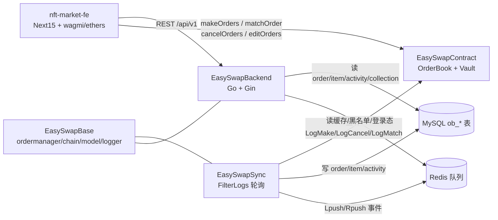
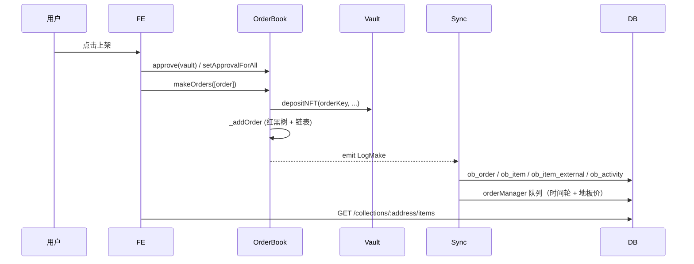

# EasySwap NFT Market 代码总结

> 本文只基于仓库中的**源代码**（Solidity / Go / TypeScript）整理，不参考 PRD、README 等文档。
> 覆盖范围：`EasySwapContract`、`EasySwapSync`、`EasySwapBackend`、`EasySwapBase`、`nft-market-fe`。

---

## 一、项目全景

四个可独立部署的模块 + 一个公共库，构成一条完整的 NFT 订单簿交易所链路：



### 架构核心特征

| 特征 | 说明 |
|---|---|
| 撮合完全在链上 | 后端只是链上状态的**只读投影**，没有中心化撮合引擎 |
| 无签名订单 | 合约继承了 EIP712，但实际只用 `msg.sender == maker` 鉴权，没有离线签名挂单 |
| 资产托管 | 挂单/出价时资产先进 `EasySwapVault`，合约只负责改记账 |
| 多链分表 | 表名按链后缀区分（`ob_order_eth` / `ob_order_sepolia` …） |
| 派生数据异步化 | 地板价、在架数、订单过期状态由 `ordermanager` 异步维护 |

### 模块职责速览

| 模块 | 语言/技术栈 | 职责 |
|---|---|---|
| `EasySwapContract` | Solidity 0.8.19 + OZ Upgradeable | 订单簿、金库、红黑树存储、校验、协议费 |
| `EasySwapSync` | Go + go-ethereum + GORM | 轮询合约事件，落库订单/物品/活动，维护地板价 |
| `EasySwapBackend` | Go + Gin + GORM + go-zero kv | REST API、登录、Portfolio、铸造、COS 上传、Admin |
| `EasySwapBase` | Go 公共库 | 链客户端、NFT 元数据、DB 模型、订单管理器、日志、工具 |
| `nft-market-fe` | Next 15 + React 19 + wagmi + ethers v6 | 前端页面与合约调用封装 |

---

## 二、合约层 `EasySwapContract`

### 1. 合约拆分（全部 UUPS 可升级，均保留 `uint256[50] __gap`）

| 合约 | 代码行数 | 职责 |
|---|---|---|
| `EasySwapOrderBook.sol` | ~1035 | 唯一对外入口：`makeOrders` / `cancelOrders` / `editOrders` / `matchOrder` / `matchOrders` / `multicall` |
| `EasySwapVault.sol` | ~167 | 资产托管，按 `OrderKey` 记账 `ETHBalance` / `NFTBalance` |
| `OrderStorage.sol` | ~342 | 红黑树（价格档）+ 同价链表（FIFO），提供 `getBestPrice` / `getBestOrder` / `getOrders` |
| `OrderValidator.sol` | ~107 | 参数校验 + `filledAmount` 成交/取消状态 |
| `ProtocolManager.sol` | ~59 | `protocolShare` 协议抽成，上限 `MAX_PROTOCOL_SHARE = 1000`（万分比） |
| `LibOrder.sol` | ~108 | 订单结构与 `OrderKey` 哈希 |
| `RedBlackTreeLibrary.sol` | ~368 | BokkyPooBah 红黑树，`type Price is uint128` |
| `LibTransferSafeUpgradeable.sol` | ~217 | solmate 风格 assembly 安全转账（ETH/ERC20/ERC721） |
| `LibPayInfo.sol` | ~21 | 手续费基数 `TOTAL_SHARE = 10000` |
| `MetaNodeNFT.sol` | ~20 | 演示用 ERC721URIStorage + `safeMint`（仅 owner） |

### 2. 订单模型

```solidity
struct Order {
    Side side;        // List 挂单 / Bid 出价
    SaleKind saleKind; // FixedPriceForCollection / FixedPriceForItem
    address maker;
    Asset nft;        // { tokenId, collection, amount(uint96) }
    Price price;      // 单价，uint128
    uint64 expiry;    // 0 表示永不过期
    uint64 salt;      // 必须非 0，保证 OrderKey 唯一
}
```

**OrderKey 计算**（`LibOrder.hash`）：

```solidity
OrderKey = keccak256(abi.encodePacked(
    ORDER_TYPEHASH, side, saleKind, maker, hash(nft), price, expiry, salt
))
```

注意：这是**自定义打包哈希**，不是 EIP-712 结构化哈希（前端 `computeOrderKey` 用 `solidityPackedKeccak256` 手工复刻）。

### 3. 资产流

| 场景 | List（挂单） | Bid（出价） |
|---|---|---|
| 下单 | NFT 进 Vault，`nft.amount` 强制 == 1 | ETH 进 Vault，锁定 `price × amount` |
| 撤单 | 从 Vault 提出 NFT 给 maker | 从 Vault 提出未成交部分 ETH 给 maker |
| 成交 | NFT 出 Vault 给买家 | ETH 出 Vault：扣手续费给卖家，差额退买家 |

入口统一处理「多传的 ETH」：`msg.value > 应付金额` 时退回差额。

### 4. 撮合只有两条路径（`_matchOrder`）

#### 路径一：卖家吃单（`msg.sender == sellOrder.maker`）

- 要求 `msg.value == 0`（卖家不需要带钱）
- 成交价 = `buyOrder.price`
- 若卖单已在簿中：`_removeOrder` + `filledAmount = amount`，从 Vault 提 NFT 给买家
- 若卖单不在簿中：`vault.transferERC721(卖家 → 买家)`，**卖家可以不带挂单直接吃 Bid**

#### 路径二：买家吃单（`msg.sender == buyOrder.maker`）

- 成交价 = `sellOrder.price`
- 若买单已在簿中：从 Vault 提 `buyPrice`，要求 `buyPrice >= fillPrice`，差额退回买家
- 若买单不在簿中（前端 `buyNow` 的临时单）：要求 `msg.value >= fillPrice`，`costValue = buyPrice` 供入口退款

#### 手续费

```solidity
protocolFee = fillPrice * protocolShare / LibPayInfo.TOTAL_SHARE  // 10000
```

手续费留在 OrderBook 合约，由 owner 通过 `withdrawETH` 提取。

### 5. 批量与聚合设计

| 函数 | 机制 | 特点 |
|---|---|---|
| `matchOrders` | `delegatecall(this)` 调 `matchOrderWithoutPayback` | 单条失败只 `emit BatchMatchInnerError`，不回滚整批 |
| `matchOrderWithoutPayback` | `onlyDelegateCall`（`address(this) != self`） | 防止被外部直接调用 |
| `multicall` | selector 白名单 + `msg.value` 敏感调用计数 | 一次最多 1 个可能消费 `msg.value` 的子调用 |
| `editOrders` | 取消旧单 + 建新单 + Vault `editNFT`/`editETH` | 只能改 price/amount，其余字段必须一致 |

`multicall` 白名单：仅 `makeOrders` / `cancelOrders` / `editOrders` / `matchOrder` / `matchOrders`，禁止调管理函数。

### 6. 存储结构（`OrderStorage`）

```solidity
mapping(OrderKey => DBOrder) orders;                 // 订单 + next 指针
mapping(address => mapping(Side => Tree)) priceTrees; // 红黑树：价格档
mapping(address => mapping(Side => mapping(Price => OrderQueue))) orderQueues; // 同价 FIFO
```

- Bid 侧取「最高价」= `tree.last()`
- List 侧取「最低价」= `tree.first()`
- 同价档内用 `head/tail` 单链表维护时间优先
- 某价格档订单全部移除后，从红黑树删除该档

### 7. 合约侧已知问题（按严重度）

1. **`getBestOrder()` 不检查 `filledAmount`/`CANCELLED`** — 已成交的最便宜订单仍会被返回，前端 `findMatchableListing()` 必须自己拉候选逐个校验（代码注释已明确说明）。
2. **EIP712 未真正使用** — `OrderValidator` 声明了 `EIP_1271_MAGIC_VALUE` 但全库无任何 `isValidSignature`/`_hashTypedDataV4` 调用。
3. **`withdrawETH` 无账目上限** — owner 可提走合约内全部 ETH（协议费 + 用户误转）。
4. **`matchOrders` 的 `msg.value - buyETHAmount`** — 极端参数下 uint128 下溢会整批回滚，而非跳过。
5. **`_editOrderTry` 哈希碰撞** — 新旧单 salt 相同会在 `_addOrder` 抛 `CannotInsertDuplicateOrder`，整批 revert。
6. **`Vault.editETH` 多收钱** — `ETHBalance[newOrderKey] = msg.value + oldETHAmount`，调用方传入超额时多出的钱静默记账。

---

## 三、索引层 `EasySwapSync`

核心文件：`service/orderbookindexer/service.go`（1665 行，单文件承担全部事件处理）。

### 1. 同步游标与批量策略

- 游标表：`ob_indexed_status`（`chain_id + index_type = 6`）
- 确认数：`MultiChainMaxBlockDifference[chain]`（eth/optimism/base/sepolia 均为 8）
- 自适应批量：
  - 落后 ≥ `MinSyncBlocks(500)`：一次 `SyncBlockPeriod(1000)` 块追赶
  - 接近链头：只同步到 `currentBlock - 确认数`，实时小批量
- 失败降级：`FilterLogs` 报错时把区间压缩到单块重试

### 2. 事件分发（`topics[0]` 硬编码 hash 匹配）

| Topic | 处理逻辑 |
|---|---|
| `LogMake` | 解析 ABI data（`orderKey/nft/price/expiry/salt`）+ topics（`side/saleKind/maker`）；写 `ob_order` / `ob_item` / `ob_item_external` / `ob_activity`；卖单额外 `syncItemOnListing` + `maintainCollectionAndItem`；最后 `AddToOrderManagerQueue` |
| `LogMatch` | 双订单状态更新（maker 单置 `Filled`，taker 单 `quantity_remaining-1` 或置 Filled）；写 Sale 活动；更新 item owner；`syncItemOnMatchOrCancel`；`AddUpdatePriceEvent(Buy)` |
| `LogCancel` | 置 `OrderStatusCancelled`；写取消活动；仅卖单清理 item 状态 |
| `ERC721ApprovalTopic` | 只写一条 activity 日志（见下方问题） |

### 3. 辅助能力

- **分叉处理** `checkAndHandleFork`：用「同 `tx_hash` 但 `block_number` 不同」判定重组 → 回滚订单状态、恢复 owner、删除旧活动
- **元数据补全** `ensureCollectionExists`：链上 `name()/symbol()/owner()/supportsInterface` 拉取，DB 已是 `Unknown` 时回填
- **地板价快照** `UpKeepingCollectionFloorChangeLoop`：定时 `MIN(list_price)` join owner 算地板价，写 `ob_collection_floor_price_*`，按 `event_time` 定期清理

### 4. 索引层已知问题（按严重度）

1. **`handleMatchEvent` 提前 return**（Sync 侧真实 bug）：当「买单不在 DB 中」时 `First(&buyOrder)` 失败即 `return`，导致后续 activity / item owner / 地板价事件全部跳过。而前端 `buyNow()` 正是构造**不入簿的临时 Bid 单**去 `matchOrder` —— 这条主流程的链上投影是断的。
2. **`Approval` 事件监听地址错误**：监听地址只有 `DexAddress`，但 `Approval` 属于 NFT 合约，DEX 永远不会发 → `handleApprovalEvent` 实际是死代码。
3. **未登记链的确认数缺失**：`MultiChainMaxBlockDifference` 无 default 分支，未注册链取到 `0`，可能同步到未确认链头。
4. **注释与常量不符**：`SyncBlockPeriod = 1000 // 每次处理8个区块`。
5. **手写 ABI 解析**：`0x06fdde03` / `0x95d89b41` / `0x01ffc9a7` / `0xc87b56dd` 全手写 selector 并手工解析返回，未复用已解析的 `parsedAbi`。
6. **表名取法混用**：`gdb.GetMultiProject*TableName` 与硬编码 `fmt.Sprintf("ob_item_external_%s", chain)` 并存。

---

## 四、业务后端 `EasySwapBackend`

### 1. 启动链路

```
main.go → config.UnmarshalConfig(viper) → svc.NewServiceContext(DB/Redis/Dao/NodeSrvs)
        → router.NewRouter(Gin + CORS + Recover + RLog)
        → app.Platform.Start()
```

### 2. 路由分层（`/api/v1`）

| 分组 | 主要接口 |
|---|---|
| `user` | `login-message` / `login` / `sig-status` |
| `collections` | `ranking`（CacheApi 60s）、详情、`items`、`bids`、`history-sales`、`token_id` 详情/traits/owner/image、`metadata` 刷新、`listing`（需登录）、`mint`（需登录） |
| `activities` | 多链活动查询 |
| `portfolio` | `collections` / `items` / `listings` / `bids` + `import-item` |
| `bid-orders` | 按 `token_ids` 批量算「最佳买价」（单品 Bid 与合集 Bid 按价格竞争） |
| `upload` | COS 直传 token/policy/callback + 服务端代理上传 |
| `metanode` | 单/批量铸造、查询（后端持私钥签名发交易） |
| `admin` | 合约地址 CRUD、NFT 导入同步、系统统计 |

### 3. 鉴权实现（`middleware/auth.go`）

```
session_id header（逗号分隔多段）
  → hex 解码
  → AES-OFB 解密（salt 硬编码 "gf_login_salt&$%"）
  → 用解密后的字符串作 Redis key 检查存在性
```

- 只做「token 是否存在于 Redis」的检查，**没有地址与 token 的绑定校验**
- `AdminMiddleware` 被注释掉，`admin` 分组只挂了登录校验
- `GetAuthUserAddress` 从 key 字符串里 `split("cache:orderbookdex:login:address:data:")` 取地址

### 4. 登录流程（`service/v1/user.go`）

1. `login-message`：生成 `Welcome to EasySwap!\nNonce:{uuid}` 存 Redis 72h
2. `login`：校验 nonce 匹配 → **签名验证代码整段被注释**（`//todo: add verify signature`）→ 发 token（`hex(AES-OFB(redisKey))`，30 天）

### 5. 数据访问模式

- 全部直接用 GORM 链式 + 原生 SQL，表名来自 `multi.*TableName(chain)`
- 列表页主导查询：

```sql
FROM ob_item_x ci JOIN ob_order_x co
  ON co.collection_address = ci.collection_address AND co.token_id = ci.token_id
WHERE co.maker = ci.owner                              -- 必须 owner 自己挂的单
  AND (ci.is_opensea_banned, co.marketplace_id) != (true, 1)  -- 双列排除
```

- 排行：读 Redis 预计算 key `cache:{project}:{chain}:ranking:volume:{epoch}`，未命中返回空数组
- Portfolio：多链并发 goroutine 聚合，`sync.WaitGroup` + `queryErr` 覆盖写（**存在 data race**）

### 6. 未完成/占位代码

| 位置 | 状态 |
|---|---|
| `MintNFT` / `performMint` | **全 mock**：返回固定假 `TxHash`、`TokenID = "1001"` |
| `isAuthorizedMinter` | 硬编码示例地址白名单 |
| `image_cfg` 相关 | 全部注释，`svcCtx.ImageMgr` 调用处保留注释 |
| `Admin*` 接口 | `AuthMiddleWare` 之后无管理员校验 |

---

## 五、公共库 `EasySwapBase`

### 1. `ordermanager` — 异步维护派生数据

| 文件 | 机制 |
|---|---|
| `service.go` | `ListenNewListingLoop`：`Lpop` Redis 订单队列 → 过期则改状态 + 发 `Expired` 事件；未过期则发 `Listing` 事件并压入过期时间轮 |
| `expiredorder.go` | 手写**时间轮**（`WheelSize = 3600`，1s 一格）：启动时分批 `id > ?` 加载全部 Active 订单，每秒扫一格，`CycleCount` 递减到 0 则异步置为 `OrderStatusExpired` |
| `floorprice.go` | 优先级队列（容量 100）维护每个 collection 最低价；按 `Buy/Mint/Listing/Cancel/Transfer/Expired/ImportCollection/UpdateCollection` 增量更新；队列空则回表 `reloadCollectionOrders`；DB 与内存双写 |
| `listcount.go` | 每 60s 重算「有效在架数」，落 Redis `cache:es:{chain}:collection:listed:{addr}` |
| `queue.go` | 最小堆 + `map[orderID]*Entry` 双结构，O(1) 删除 + O(log n) 取 min/max |

共同前提：**只有 `maker == item.owner` 的挂单才算有效**。owner 变更（Transfer）时 `RemoveMakerOrders` + 重新拉买家有效单。

### 2. 其他子包

| 子包 | 说明 |
|---|---|
| `chain/chainclient` | 仅支持 `EthChainID` / `OptimismChainID` / `SepoliaChainID` |
| `chain/nftchainservice` | tokenURI 支持 `data:application/json;base64` / `ipfs://` / `http(s)` 三种形式 |
| `stores/gdb/orderbookmodel` | 模型：`order` / `item` / `item_external` / `item_trait` / `collection` / `collection_floor_price` / `collection_trade` / `activity` / `indexed_status` |
| `stores/xkv` | Redis 封装（String/List/Set/Hash） |
| `errcode` / `xhttp` / `logger(xzap)` / `retry` / `kit/*` | 错误码、HTTP 封装、日志、重试、工具函数 |
| `evm/erc/erc721` | ERC721 合约绑定与 NFT 查询 |

### 3. 数据模型关键字段（`multi.Order`）

```go
OrderType: 1=Listing 2=Offer 3=CollectionBid 4=ItemBid
OrderStatus: 0=Active 1=Inactive 2=Expired 3=Cancelled 4=Filled 5=NeedSign
```

---

## 六、前端 `nft-market-fe`

### 1. 技术栈

Next 15（App Router）+ React 19 + wagmi/RainbowKit + ethers v6 + TanStack Query + Tailwind + COS SDK。

### 2. 页面结构

| 路由 | 内容 |
|---|---|
| `/collections` | 合集列表（`collections-table` / `market-hero` / `trending`） |
| `/collections/[name]` | 合集详情：`collection-header` / `items-grid` / `listings-table` / `collection-bids-panel` / `place-bid-dialog` / `place-item-bid-dialog` / `trait-filters` / `trading-view` / `recent-activity` |
| `/collections/[name]/[tokenId]` | 单品详情 `item-detail-view` |
| `/portfolio` | 我的资产、挂单记录、出价、导入（`import-nft-panel` / `listingNftDialog` / `listingDailog` / `main-content`） |
| `/activity` | 活动流 + 图表 |
| `/mint` | 铸造页（含 `test-credentials.tsx`、`test-upload.tsx`） |
| `/airdrop` | 静态 UI（`rarity-boxes` / `season-tabs`） |

### 3. 合约调用封装 `contracts/service/orderBookContract.ts`

这是前端最核心的资产，做了大量「补合约坑」的工作：

| 函数 | 作用 |
|---|---|
| `computeOrderKey()` | 用 `solidityPackedKeccak256` **手工复刻** `LibOrder.hash`，用于查 `filledAmount` |
| `toPlainOrder()` | 把 ethers v6 的 frozen `Result` 转普通对象，规避 `Cannot assign to read only property '0'` |
| `findMatchableListing()` | 绕过 `getBestOrder` 不检查成交状态的缺陷：拉候选 → 算 key → 查 `filledAmount` |
| `buyNow()` | 构造**不入簿的临时 Bid 单**，`value = 卖单价`，直接 `matchOrder` |
| `makeBid()` / `matchBid()` | 出价 / 卖家接受出价 |
| `cancelOrder()` / `editOrder()` | 撤单 / 改价 |
| `approveNFT()` / `checkNFTApproval()` | 授权目标是 **Vault 地址**（不是 OrderBook） |
| `normalizeBuyError()` | `HD: order closed` / `OVa: expired` / `OVa: canceled` 等 revert 翻译成中文提示 |

交易状态通过 `window.dispatchEvent(CustomEvent('tx-message'))` 上报，由 `components/ui/tx-message-center.tsx` 统一展示。

### 4. 前端硬编码项

| 项 | 位置 |
|---|---|
| OrderBook 地址 `0xB609...2B5c` | `orderBookContract.ts` |
| Vault 地址 `0x3AD0...99bc` | `orderBookContract.ts` |
| Infura RPC key | `config/wagmi.ts` |
| RainbowKit `projectId` | `config/wagmi.ts` |
| WS `wss://sepolia.gateway.tenderly.co` | `hooks/useChainWebSocket.ts` |
| 默认 `chain_id = 11155111` | `hooks/useGlobalState.ts` |

`useGlobalState` 本质是把全局状态塞进 localStorage 的 TanStack Query 包装。

---

## 七、端到端数据流

### 挂单



### 买断

1. 前端 `findMatchableListing()` 链上读候选 + 校验 `filledAmount`
2. 构造临时 Bid 单（不入簿），`matchOrder(sellOrder, buyOrder, {value})`
3. 合约走路径二：提 NFT 给买家、扣手续费给卖家、差额退回
4. `emit LogMatch` → Sync 更新订单状态与 owner
   - ⚠️ **临时买单不在 DB 时会提前 return，后续投影中断**

### 地板价

```
LogMake(卖单) → AddUpdatePriceEvent(Listing)
             → floorPriceProcess 优先级队列
             → checkAndUpdateFloorPrice 写 ob_collection.floor_price
```

前端排行另有一份 Sync 定时快照（`ob_collection_floor_price_*`）。

---

## 八、代码层面的核心结论

### 做得扎实的地方

- 红黑树 + 链表实现**价格优先 + 时间优先**的盘口结构
- Vault 与 OrderBook 权限隔离清晰（`onlyEasySwapOrderBook`）
- `onlyDelegateCall` + `msg.value` 单次限制的 multicall 安全设计
- Indexer 的自适应批量、单块降级、分叉回滚
- 前端对 ethers frozen Result、`getBestOrder` 缺陷、revert 文案的四处针对性补丁
- 派生数据（地板价 / 在架数 / 过期）异步解耦，不阻塞主事件流

### 明确的破绽（按严重度排序）

| # | 问题 | 位置 | 影响 |
|---|---|---|---|
| 1 | `handleMatchEvent` 在买单不在 DB 时提前 `return` | `EasySwapSync/.../service.go` | `buyNow` 主流程的订单/owner/活动不落库 |
| 2 | 登录**没有验签**，只有 nonce 比对 | `Backend/service/v1/user.go` | 任何人可伪造 session |
| 3 | `AdminMiddleware` 被注释，admin 无权限校验 | `Backend/api/router/v1.go` | 管理接口裸奔 |
| 4 | AES salt 硬编码在源码 | `Backend/api/middleware/auth.go` | token 可离线解密 |
| 5 | `MintNFT` 是 mock | `Backend/service/v1/collection.go` | 返回假 txHash / tokenId |
| 6 | `getBestOrder` 不过滤 `filledAmount`/`CANCELLED` | `OrderStorage.sol` | 视图接口给出已成交订单 |
| 7 | `Approval` 事件监听错地址 | `EasySwapSync/.../service.go` | 死代码 |
| 8 | EIP712 声明但未使用 | `OrderValidator.sol` | 名义 EIP712，实际无签名订单 |
| 9 | 私钥 / Infura key / COS 密钥 / 合约地址明文 | 配置与源码 | 密钥泄露风险 |
| 10 | Portfolio 聚合 `queryErr` 跨 goroutine 无锁写 | `Backend/service/v1/portfolio.go` | data race |
| 11 | `matchOrders` 的 `msg.value - buyETHAmount` 可能下溢 | `EasySwapOrderBook.sol` | 整批意外回滚 |
| 12 | `Vault.editETH` 多收的 `msg.value` 静默记账 | `EasySwapVault.sol` | 资金记账偏差 |

---

## 九、改进优先级建议

1. **修 `handleMatchEvent` 的提前 return** — 改为「买单不存在则跳过买单状态更新，继续后续 activity / owner / 地板价逻辑」，否则买断主流程数据是坏的。
2. **补登录验签** — 用 `ethers.verifyMessage` / `ecrecover` 校验 `address + nonce` 签名，并把 nonce 做成一次性。
3. **恢复 `AdminMiddleware`** 并对管理接口加真实权限校验。
4. **`getBestOrder` 增加 `filledAmount` 过滤** — 或者直接废弃该接口，统一走 `getOrders` + 前端过滤。
5. **把密钥迁到环境变量/密钥管理** — 至少把 `config.toml.example` 里的私钥换成占位符。
6. **要么真正实现 EIP712 签名订单，要么删掉相关继承与常量**，避免误导。
7. **`Approval` 事件要么监听 NFT 合约，要么直接删除该分支**。
