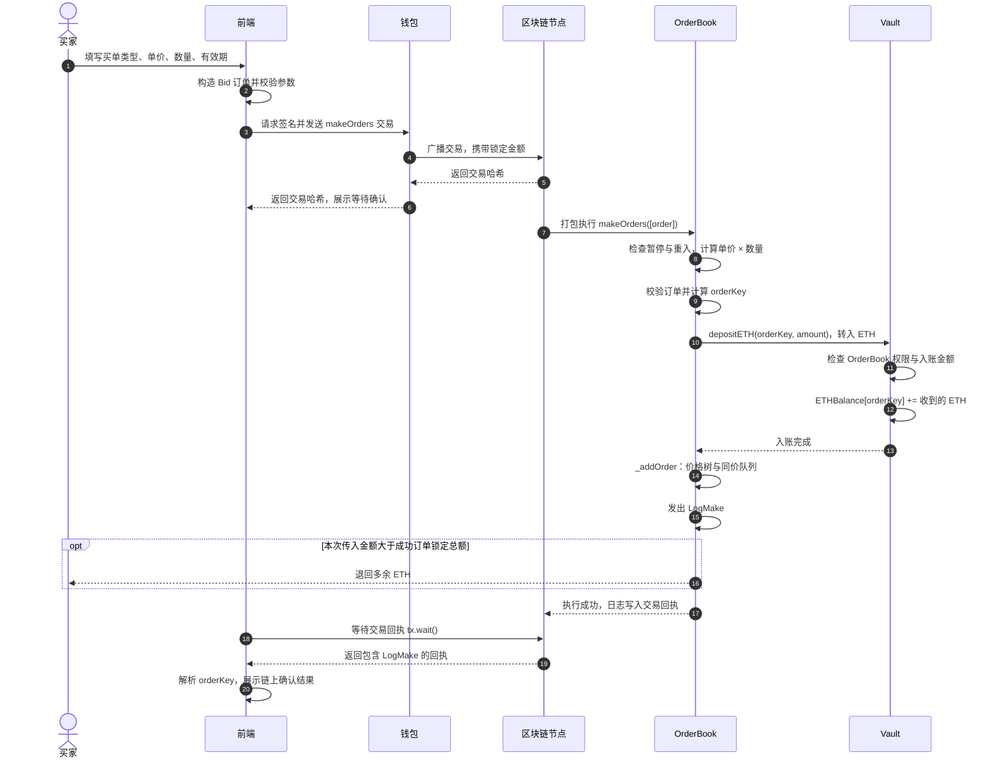
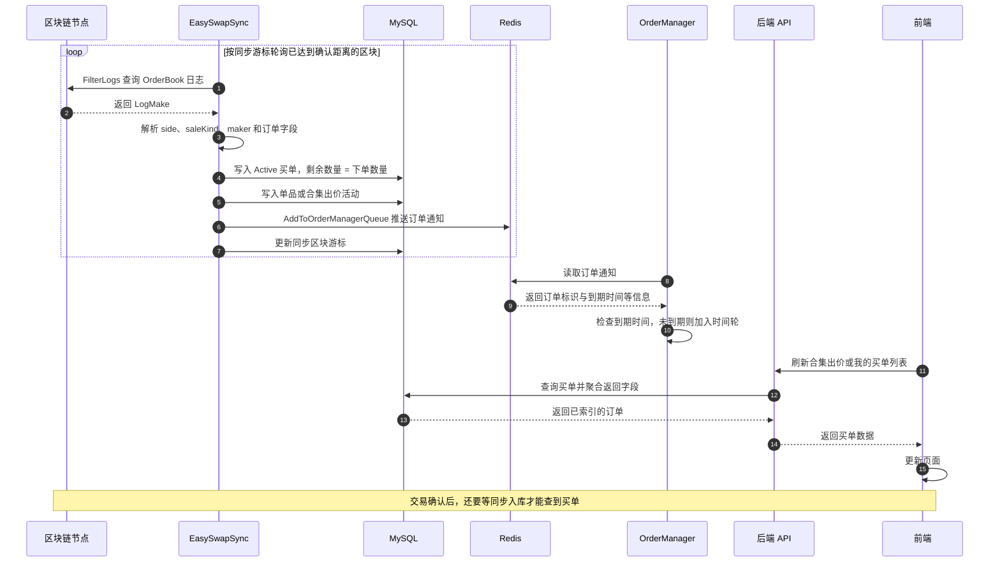

# 业务理解

NFTMarket 是一个 NFT 订单簿交易市场，主要业务是挂买单、挂卖单和订单撮合。买家可以对单个 NFT 出价，也可以对整个合集出价。

## 整体流程

# 工程理解

## 结构

- EasySwapContract：订单簿、撮合和资产托管合约
- EasySwapBase：后端和同步服务共用的数据库、RPC、订单管理等代码
- EasySwapSync：读取链上事件，更新订单和统计数据
- EasySwapBackend：提供查询、导入、上传和铸造接口
- nft-market-fe：前端页面和钱包交互

## 关键点

### 挂买单

#### 买单是什么

挂买单就是买家先报价、锁钱，等待卖家接受。买家填写单价、购买数量和有效期，把 `单价 × 数量` 的 ETH 存入 Vault，合约记录一张 Bid 订单。钱包还要留出支付 Gas 的 ETH。

Vault 用 `orderKey` 记录这笔钱。此时 NFT 还没有转移，买家也不需要授权 NFT。挂单后不会自动成交，需要有人调用撮合函数。

| 买单类型 | 合约参数 | 前端构造方式 |
| --- | --- | --- |
| 单品买单 | `side = Bid(1)`，`saleKind = FixedPriceForItem(1)` | 指定合集与 tokenId，数量为 1 |
| 合集买单 | `side = Bid(1)`，`saleKind = FixedPriceForCollection(0)` | 指定合集，tokenId 使用 0 占位，数量由用户填写 |

例如，对一个合集出价 `0.01 ETH`，买 `3` 件，就要锁定 `0.03 ETH`。这表示买 3 个 NFT，每个单价为 0.01 ETH。合集买单本应只接收指定合集的 NFT，当前撮合函数还缺少这项地址检查。

#### 下单过程

1. 前端组装订单：`maker` 填当前钱包地址，`price` 用 `parseEther()` 转成 wei，`expiry` 填秒级到期时间，`salt` 用 `Date.now()` 生成。
2. 前端 `makeOrders()` 检查参数，调起钱包向 OrderBook 发交易，随交易带上买单要锁定的 ETH。
3. 合约 `makeOrders()` 有暂停检查和重入保护。它逐笔计算 `单价 × 数量`，再交给 `_makeOrderTry()` 处理。
4. `_makeOrderTry()` 检查 maker、价格、salt、有效期、历史成交状态和数量，计算 `orderKey`，调用 `Vault.depositETH()` 存钱。
5. Vault 确认调用者是 OrderBook、金额足够后，更新 `ETHBalance[orderKey]`。OrderBook 再调用 `_addOrder()` 入簿：价格放进红黑树，同价订单排到队尾。
6. 合约发出 `LogMake`，退回多带的 ETH。前端等到交易回执后，从事件里取出 `orderKey`。
7. EasySwapSync 随后读取链上日志并入库，OrderManager 处理到期等状态。页面刷新查询后才会显示这笔买单。

关键源码：[前端订单服务](../nft-market-fe/contracts/service/orderBookContract.ts)、[合集出价弹窗](../nft-market-fe/app/collections/[name]/components/place-bid-dialog.tsx)、[单品出价弹窗](../nft-market-fe/app/collections/[name]/components/place-item-bid-dialog.tsx)、[OrderBook](../EasySwapContract/contracts/EasySwapOrderBook.sol)、[Vault](../EasySwapContract/contracts/EasySwapVault.sol)、[订单存储](../EasySwapContract/contracts/OrderStorage.sol)。

#### 链上下单时序

图中是单笔买单成功的过程。OrderBook 继承了 OrderStorage，`_addOrder()` 在合约内部执行。

#### 入库和页面刷新时序

同步服务通过 RPC 拉日志，图中只保留买单入库和查询过程。交易确认后，同步服务可能还没处理到这个区块，所以页面不一定马上能查到订单。

#### 代码里要留意的地方

- 挂单的钱先留在 Vault，成交时才付给卖家、扣协议费。
- 部分无效订单会被跳过。交易确认后，还要看有没有对应的 `LogMake`，才能确定买单建成。
- 过期不会自动退款，需要链上撤单。已经部分成交的，只退剩余数量对应的 ETH。
- 合约把 `expiry = 0` 当作永不过期，链下过期管理和部分查询还没有按同样方式处理，可能出现链上有效、页面却查不到的情况。
- 合集出价弹窗用浮点乘法，再保留六位小数算总额，可能与链上按 wei 计算的金额有差异。
- `handleMakeEvent()` 处理买单时也会尝试补建 item，把 maker 写成新记录的 owner。出价者此时还没拿到 NFT，这个字段不能直接当作链上所有权。

### 挂卖单
### 订单撮合
### 数据同步
