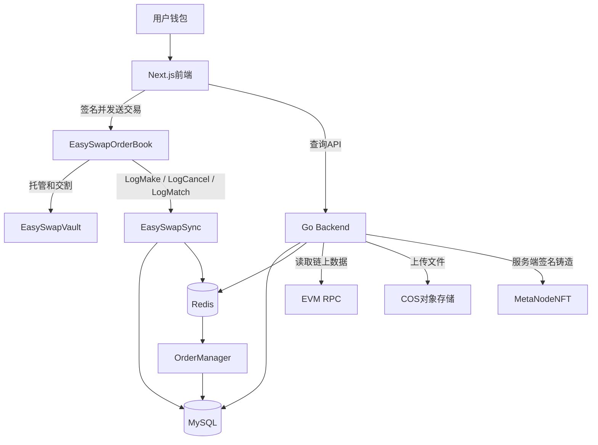
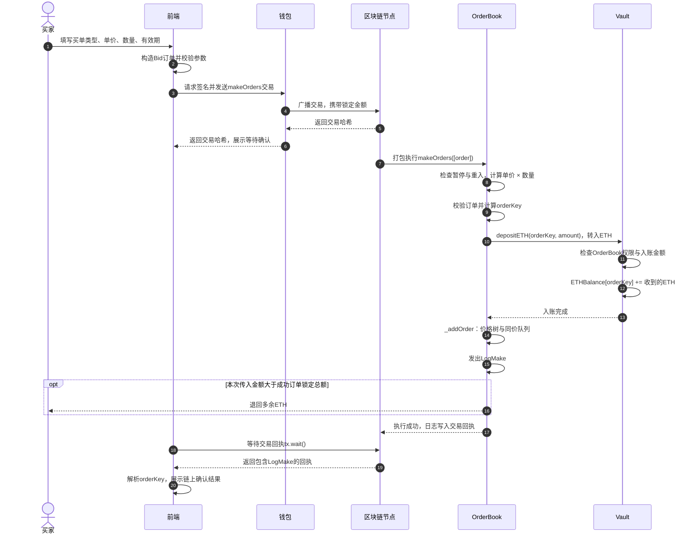
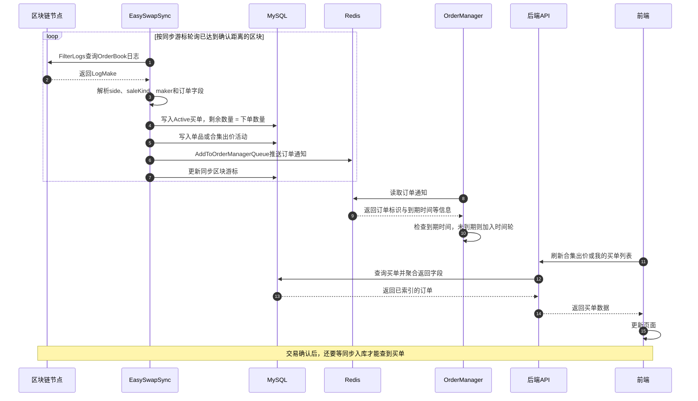
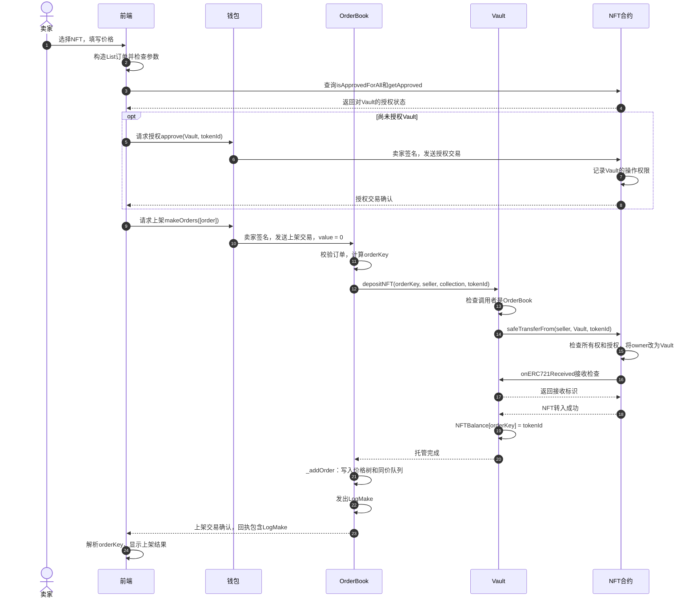
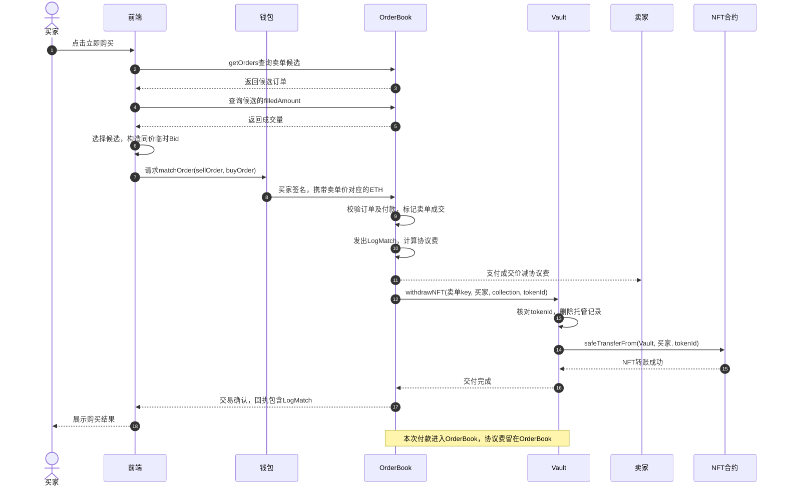
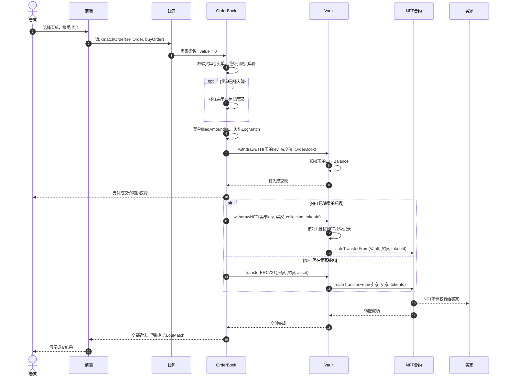
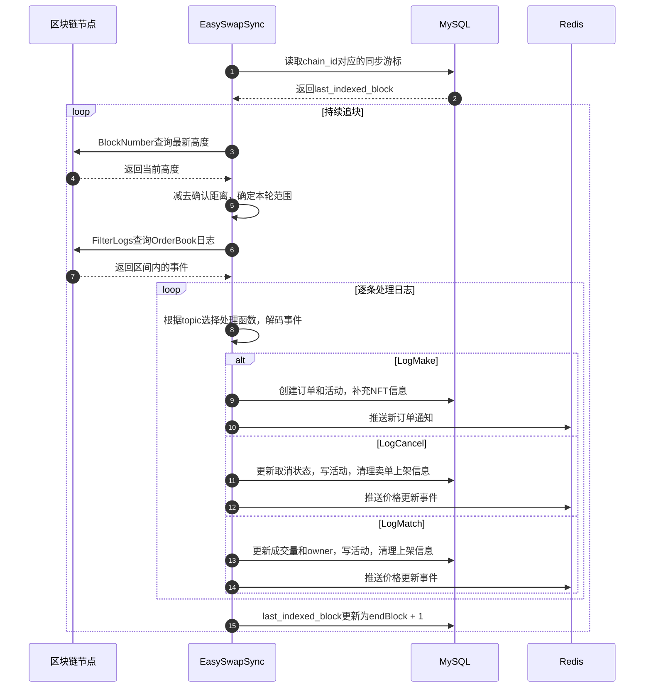
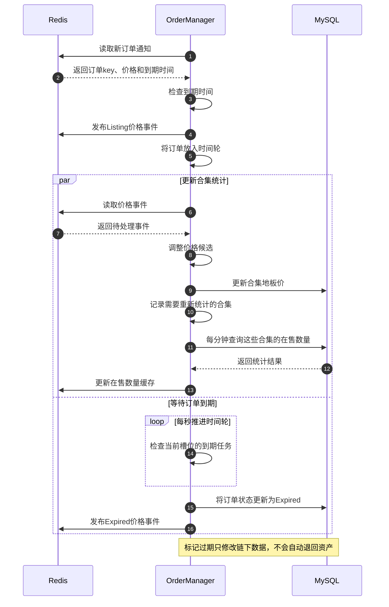

# 业务理解

NFTMarket用订单簿组织NFT交易。买家挂买单时先锁定ETH，卖家挂卖单时先把NFT存入Vault。买家购买或卖家接受出价后，合约完成付款和NFT转移。

买单分为单品出价和合集出价。单品出价指定一个NFT，合集出价则指定合集、单价和购买数量。

## 整体流程

交易由钱包调用链上合约完成。EasySwapSync读取合约事件，把订单变化写入数据库。前端通过后端API查询这些数据，所以交易已经确认时，页面可能还没更新。

图里的OrderManager是由EasySwapSync启动的链下订单管理模块，负责标记订单过期、更新合集地板价和在售数量。它更新数据库和缓存，实际成交和资产转移由合约处理。

# 工程理解

## 结构

项目分成五部分。合约在链上执行，后端和同步服务分别运行，前端负责页面操作。EasySwapBase是它们使用的Go公共库。

- `EasySwapContract`：存放智能合约。OrderBook管订单和撮合，Vault托管ETH和NFT，MetaNodeNFT负责NFT铸造。
- `EasySwapBase`：后端和同步服务共用的Go代码，包括数据模型、MySQL、Redis、RPC和日志。OrderManager也在这里，由同步服务启动。
- `EasySwapSync`：持续读取链上日志。它把挂单、撤单和成交写入数据库，再更新过期状态、地板价和在售数量。
- `EasySwapBackend`：向前端提供HTTP接口。列表和详情主要从数据库、Redis查询，也会调用RPC读取链上信息。上传、NFT导入和服务端铸造也由它处理。
- `nft-market-fe`：Next.js前端。页面数据通过后端接口获取，挂单和撮合由用户钱包直接调用合约。铸造页面则请求后端发送交易。

## 关键点

### 挂买单

#### 买单是什么

挂买单时，买家先确定愿意出多少钱、买几件、等多久。下单后，`单价 × 数量`的ETH存入Vault，订单记为Bid。钱包里还需要留出支付Gas的ETH。

Vault按`orderKey`记录每张买单锁定的钱。买家此时还没拿到NFT，也不用做NFT授权。等卖家接受出价、调用撮合函数后，才会付款和转移NFT。

| 买单类型 | 合约参数 | 前端构造方式 |
| --- | --- | --- |
| 单品买单 | `side = Bid(1)`，`saleKind = FixedPriceForItem(1)` | 指定合集与tokenId，数量为1 |
| 合集买单 | `side = Bid(1)`，`saleKind = FixedPriceForCollection(0)` | 指定合集，tokenId使用0占位，数量由用户填写 |

例如，每件出价`0.01 ETH`，想买某个合集中的`3`件NFT，就要锁定`0.03 ETH`。具体买到哪几个token，由后续撮合决定。当前撮合函数还缺少合集地址检查，可能接受到其他合集的NFT。

#### 下单过程

1. 前端组装订单。`maker`是当前钱包地址，`price`用`parseEther()`转成wei。`expiry`填秒级到期时间，`salt`用`Date.now()`生成。
2. 前端`makeOrders()`检查参数，再调起钱包发送交易。买单要锁定的ETH通过`msg.value`一起转给OrderBook。
3. 合约`makeOrders()`有暂停检查和重入保护。它逐笔计算锁定金额，再调用`_makeOrderTry()`。
4. `_makeOrderTry()`检查下单人、价格、salt、有效期和数量，确认订单没有成交或取消记录。通过检查后，计算`orderKey`，调用`Vault.depositETH()`存入ETH。
5. Vault检查调用者和金额，把收到的钱记入`ETHBalance[orderKey]`。OrderBook随后调用`_addOrder()`，将价格放进红黑树，订单排到同价队列末尾。
6. 合约发出`LogMake`，退回多带的ETH。前端拿到交易回执后，从事件里取出`orderKey`。
7. EasySwapSync读取这笔交易的日志，把订单写入数据库。OrderManager接收订单通知，安排过期检查。前端再次查询后，页面才会显示这笔买单。

关键源码：[前端订单服务](../nft-market-fe/contracts/service/orderBookContract.ts)、[合集出价弹窗](../nft-market-fe/app/collections/[name]/components/place-bid-dialog.tsx)、[单品出价弹窗](../nft-market-fe/app/collections/[name]/components/place-item-bid-dialog.tsx)、[OrderBook](../EasySwapContract/contracts/EasySwapOrderBook.sol)、[Vault](../EasySwapContract/contracts/EasySwapVault.sol)、[订单存储](../EasySwapContract/contracts/OrderStorage.sol)。

#### 链上下单时序

下面是一张买单成功提交的过程。`_addOrder()`来自OrderStorage，由OrderBook在内部调用。

#### 入库和页面刷新时序

交易确认后，还要等同步服务处理到对应区块。买单写进数据库后，后端API才能查到。图中省略了元数据补全等操作。

#### 代码里要留意的地方

- ETH在挂单时锁进Vault，成交时才扣手续费、付给卖家。
- 无效订单可能被跳过，所以交易确认后还要检查对应的`LogMake`，确认买单确实创建了。
- 到期不会自动退款。买家需要撤单，取回未成交数量对应的ETH。
- 合约允许`expiry = 0`，表示永不过期。链下部分代码却会把它当成已过期，导致链上订单还有效，页面已经查不到。
- 合集出价弹窗用浮点乘法计算总额，只保留六位小数。这个结果可能与链上按wei计算的锁定金额不一致。
- `handleMakeEvent()`会尝试为买单补建item，并把maker写入新记录的owner。挂买单并没有转移NFT，这个owner不能当作链上所有权。

### 挂卖单

#### 卖单是什么

挂卖单时，卖家给NFT定好价格，再把它存入Vault，等待买家购买。比如挂价`0.02 ETH`，这笔钱要等成交后才能收到，还会扣掉协议费。

如果还没授权，卖家要先允许Vault操作NFT，再向OrderBook发起挂单。授权和上架分别需要Gas，纯卖单不用另外存入ETH。

上架成功后，链上的`ownerOf(tokenId)`返回Vault地址。卖家仍是订单的maker，可以通过撤单取回NFT。

批量上架时，每个NFT都有单独的卖单，各自记录tokenId、价格和`orderKey`。

#### 订单怎么填

| 字段 | 当前前端的取值 |
| --- | --- |
| `side` | `List(0)`，卖单 |
| `saleKind` | `FixedPriceForItem(1)`，单品定价出售 |
| `maker` | 当前卖家钱包地址 |
| `nft.collection` | NFT合约地址 |
| `nft.tokenId` | 要出售的NFT编号 |
| `nft.amount` | 固定为1 |
| `price` | `parseEther(输入价格)`，单位为wei |
| `expiry` | 当前秒级时间加100000，约27小时47分钟后到期 |
| `salt` | `Date.now() + index`，用索引区分同批订单 |

#### 授权给谁

挂单交易发给OrderBook，转走NFT的却是Vault。因此，NFT的授权地址要填Vault。

`checkNFTApproval()`先用`isApprovedForAll()`查卖家是否授权Vault操作该合集的全部NFT。如果没有，再用`getApproved(tokenId)`查这个NFT是否单独授权给了Vault。

两项都没有通过时，前端发送`approve(Vault, tokenId)`，等授权确认后再挂单。已经授权的直接跳过。批量上架也按这个顺序逐个检查。

授权成功后，NFT还在卖家钱包里。直到执行`makeOrders()`，Vault才会把它转入托管。

#### 上架过程

1. 卖家在持仓页选中NFT并填写价格。前端逐个构造卖单，调用`makeOrders(signer, orders, { autoApprove: true })`。
2. 前端检查参数和授权。需要授权的先发授权交易，确认后再继续。
3. 钱包向OrderBook发送`makeOrders(orders)`，纯卖单的`msg.value`为0。合约入口会检查暂停状态，并防止重入。
4. `_makeOrderTry()`检查下单人、价格、salt、有效期和历史成交状态。卖单数量必须为1，通过检查后计算`orderKey`。
5. OrderBook调用`Vault.depositNFT()`。Vault确认调用者是OrderBook，再调用NFT合约的`safeTransferFrom()`，将NFT从卖家转入Vault。
6. Vault记录`NFTBalance[orderKey] = tokenId`。OrderBook再调用`_addOrder()`，把价格放进List价格树，将订单排到同价队列末尾。查询时先取低价，同价按入簿顺序遍历。
7. 合约发出`LogMake`。前端拿到回执后取出`orderKey`。页面列表要等事件入库，再次查询后才会更新。

关键源码：[持仓页上架](../nft-market-fe/app/portfolio/components/main-content.tsx)、[上架弹窗](../nft-market-fe/app/portfolio/components/listingNftDialog.tsx)、[前端授权与下单](../nft-market-fe/contracts/service/orderBookContract.ts)、[OrderBook](../EasySwapContract/contracts/EasySwapOrderBook.sol)、[Vault](../EasySwapContract/contracts/EasySwapVault.sol)、[订单存储](../EasySwapContract/contracts/OrderStorage.sol)。

#### 授权和上架时序

下面是一件NFT上架成功的过程。已授权时跳过授权交易。`_addOrder()`由OrderBook在内部调用。

#### 代码里要留意的地方

- 授权和上架是独立交易。上架失败，已经确认的授权仍然有效。批量授权中途失败，前面成功的授权也会保留。
- NFT存进Vault后，卖家无法再从自己的钱包直接转走它。撤单由Vault归还，成交由Vault交给买家。
- `NFTBalance`记录的是tokenId。tokenId可以为0，所以这个字段等于0，不一定表示没有托管NFT。
- 订单到期不会自动归还NFT，卖家仍要撤单取回。数据库的owner可能为了展示挂单而保留卖家地址，与链上的Vault地址不同。
- 批量挂单时，部分无效订单会被跳过。如果NFT转账或入簿revert，整笔上架交易都会回滚。之前单独确认的授权交易不会回滚。
- 前端收到回执就会提示成功，还要检查对应的`LogMake`和`orderKey`，确认选中的NFT已经上架。挂单后不会自动接受已有买单。

### 订单撮合

#### 撮合是怎么发生的

撮合由买家或卖家发起。用户选好订单后，调用`matchOrder(sellOrder, buyOrder)`，合约才会执行交易。即使买价已经高于卖价，也不会自动成交。

调用者必须是买单或卖单的maker，第三方不能直接拿两张订单来撮合。

订单检查、成交量更新、ETH结算和NFT交付都在同一笔交易里完成。任何一步revert，前面的操作和事件都会回滚，但已执行的交易仍会消耗Gas。

| 谁发起 | 哪张订单必须已入簿 | 成交价 | 钱从哪里来 | NFT从哪里来 |
| --- | --- | --- | --- | --- |
| 买家购买 | 卖单 | 卖单价 | 临时买单随交易付款，已有买单从Vault扣款 | 已托管在Vault的NFT |
| 卖家接受出价 | 买单 | 买单价 | 买单锁在Vault的ETH | 已挂单的从Vault提取，未挂单的从卖家钱包转出 |

主动成交的一方可以临时组装自己的订单，不必先调用`makeOrders()`。比如买家立即购买时，卖单已经入簿，买家只需组装一张临时买单，带上ETH发起交易。

#### 成交前检查什么

`_matchOrder()`先计算两个订单key，再由`_isMatchAvailable()`检查以下条件。

- 两个订单key不同，方向分别为List和Bid。
- 卖单是`FixedPriceForItem`，买卖双方不能是同一个maker。
- 单品买单的collection和tokenId必须与卖单一致。当前合集买单会直接通过这项检查，缺少同合集限制。
- 两张订单都没完全成交，即`filledAmount`小于下单数量。撤单会把成交量设为最大整数，因此也无法通过这项检查。

接下来按调用者身份进入买家或卖家分支，继续检查订单是否存在，以及maker、salt、价格或NFT地址等字段。

有效期检查对两方的处理不同。对手方已经挂出的订单必须未过期。主动成交的一方使用已有订单时，合约会跳过自己这张订单的到期检查，使用临时订单时则会检查。

#### 买家购买

点击“立即购买”后，前端调用`buyNow()`。它先用`findMatchableListing()`查找卖单，排除空记录、自己的挂单、过期单和已成交单。选中的订单会从ethers的只读结构转成普通对象，供后续交易使用。

前端再组装一张临时Bid。maker填买家地址，NFT、数量和价格沿用卖单。钱包带上对应ETH调用`matchOrder()`，买家不用提前挂买单，也不用授权NFT。

合约检查卖单仍存在、未过期且未关闭，并确认付款足够。通过后标记卖单成交，发出`LogMatch`，扣除协议费并给卖家付款。最后由Vault把NFT转给买家。

前端拿到回执后显示购买结果，再延迟刷新页面，等待同步服务更新数据。

合约也支持买家使用已有买单购买。这时要求买单价不低于卖单价，付款从Vault中提取，多出的价差退给买家。当前代码还会移除整张买单，并把成交量加1，多件买单在这里有剩余数量处理问题，后面单独列出。

#### 买家购买时序

图中是前端`buyNow()`的用法。临时买单价、卖单价和付款金额相同。

#### 卖家接受出价

卖家选好已有买单，用自己的卖单和它一起调用`matchOrder()`。这笔交易的`msg.value`必须为0，成交款直接从买家之前锁在Vault的ETH中扣除。

成交价取买单价。例如原先挂价0.02 ETH，卖家选择接受0.018 ETH的出价，就按0.018 ETH成交。合约不会再要求买价达到原来的挂价。

NFT已经挂单时，合约移除卖单并标记成交，再从Vault交付NFT。尚未挂单时，可以临时构造卖单，由Vault直接从卖家钱包转给买家。这种用法需要提前授权Vault。

每次成交，买单的`filledAmount`加1，Vault扣除一份单价。比如买3件、每件0.01 ETH，第一件成交后，成交量为1，Vault还剩0.02 ETH。走卖家接受出价这条分支时，买单会留在簿中，可以继续接收NFT，直到数量用完。

当前详情页的`handleMatch()`要求卖单和买单都存在，才调用`matchBid()`。页面还不能让未挂单的卖家直接接受出价。

#### 卖家接受出价时序

图中列出两种交付方式。NFT仍在卖家钱包时，需要先授权Vault。

#### 手续费和事件

手续费按`成交价 × protocolShare / 10000`计算，使用wei做整数运算。Owner可以调整费率，上限为10%。

假设费率为2%，成交价为0.02 ETH，卖家收到0.0196 ETH。剩下的0.0004 ETH留在OrderBook，由Owner提取。

`LogMatch`记录订单key、完整订单和成交价。makeOrder和takeOrder的顺序取决于谁发起交易。

| 发起方 | makeOrder | takeOrder |
| --- | --- | --- |
| 买家 | 买单 | 卖单 |
| 卖家 | 卖单 | 买单 |

解析时要根据`side`判断买卖方向。makeOrder不一定是卖单，takeOrder也不一定是买单。

代码先发出事件，再付款和转移NFT。后续交割失败时，事件也会回滚，不会留下成功的成交记录。

#### 批量撮合

`matchOrders()`用`delegatecall`逐对撮合订单。成功的记录结果和花费，失败的发出`BatchMatchInnerError`，然后继续处理下一对。最后统一退回多余ETH。

因此，批量撮合可以部分成功，源码注释里的“全部成功或全部失败”与实现不符。不过外层退款等操作一旦失败，整笔交易仍会回滚。

#### 代码里要留意的地方

- 买家购买后，卖单成交量会更新，但订单仍留在价格队列里。查询函数不检查成交量，前端需要额外读取`filledAmount`，确认它还能成交。
- 买家用已有多件买单购买一次，代码会移除整张买单，成交量却只加1。剩余ETH仍可能锁在Vault，后续查询和撤单都会受影响。
- 临时买单按卖单价检查付款，却按买单价计算退款。两个价格不同会出现金额问题。前端`buyNow()`使用同价，避开了这种情况，但合约本身还没处理好。
- `findMatchableListing()`默认只查10条，也没有翻页。卖单查询不筛选目标tokenId，前端又没核对，可能买到同合集的其他NFT。
- 合集买单缺少同合集检查。前端`matchBid()`还把买单类型写成单品，并沿用页面传入的数量1，不能正确还原合集买单。字段变了，算出的key也会变，合约就查不到原买单。
- 使用已有订单时，参与哈希的字段都要保持原样，包括价格、数量、有效期和salt。

关键源码：[撮合合约](../EasySwapContract/contracts/EasySwapOrderBook.sol)、[订单检查与成交量](../EasySwapContract/contracts/OrderValidator.sol)、[Vault交割](../EasySwapContract/contracts/EasySwapVault.sol)、[费率常量](../EasySwapContract/contracts/libraries/LibPayInfo.sol)、[前端购买与接受出价](../nft-market-fe/contracts/service/orderBookContract.ts)、[详情页入口](../nft-market-fe/app/collections/[name]/[tokenId]/components/item-detail-view.tsx)。

### 数据同步

#### 为什么要同步

挂单、撤单和成交发生在链上，页面列表主要从数据库查询。EasySwapSync负责读取合约事件，把链上变化写成订单、NFT和活动记录，供后端API使用。

例如买家已经买到NFT，钱包里也能查到，但页面还显示原来的卖家。这时要检查成交事件是否已经入库。交易确认、数据库更新和页面刷新是三个先后发生的步骤。

同步服务还会补充合集名称、图片等信息，并维护地板价和在售数量。它不会替用户发送成交或撤单交易，也不会操作Vault里的资产。

#### 服务怎么启动

`EasySwapSync`通过`daemon`命令启动，创建数据库、Redis、链客户端、订单索引器和OrderManager。

启动时先从数据库预加载合集，再启动后台任务。索引器负责追块和保存地板价快照，OrderManager负责接收订单通知、处理过期、更新地板价和在售数量。

OrderManager的代码在EasySwapBase中，随同步服务一起运行，不是单独部署的服务。

#### 从哪个区块开始

`SyncOrderBookEventLoop()`先读取`ob_indexed_status`，用`chain_id`和`index_type = 6`找到订单事件的同步进度。

`last_indexed_block`在当前实现里表示下一次要读取的区块。比如这轮处理完100到200，就把它更新为201。重启后从201继续，不需要从头扫描。

为了给区块确认留出距离，代码不会立即处理最新区块。当前已列出的链使用8个区块的间隔，最新高度为1000时，同步上限就是992。

1. 调用`BlockNumber()`获取最新高度，减去确认距离，得到本轮可处理的上限。
2. 从同步游标开始确定查询范围。落后至少500个区块时，按较大范围追赶，接近链头时直接处理剩余区块。
3. 调用`FilterLogs()`，只查询OrderBook地址发出的日志。
4. 按日志的topic分发到挂单、撤单和成交处理函数。
5. 这一轮结束后，把同步游标改成`endBlock + 1`。

大范围查询使用`endBlock = startBlock + 1000`，包含首尾时最多覆盖1001个区块。RPC查询失败且范围足够大时，会缩成单区块重试。还没等到可同步区块，或查询再次失败时，等待10秒后继续。

#### 事件写到哪里

事件通过ABI解码，订单key和部分索引字段从topics读取，其余字段从data读取。卖单、单品买单和合集买单会转成不同的数据库订单类型。

| 事件 | 主要处理 | 对页面的影响 |
| --- | --- | --- |
| `LogMake` | 创建Active订单，记录下单数量和剩余数量，写入挂单或出价活动 | 出现新的挂单或买单 |
| `LogCancel` | 将订单改为Cancelled，记录取消活动 | 订单不再作为活跃订单展示 |
| `LogMatch` | 将卖单改为Filled，减少买单剩余数量，记录成交并更新NFT的owner | 显示成交记录、新持有人和下架状态 |

订单写入`ob_order_<chain>`，活动写入`ob_activity_<chain>`。NFT本身的信息、图片和合集数据分别保存在对应的item、item_external和collection表中。

挂卖单时，代码还会补建合集，读取链上的名称、符号和tokenURI，并更新item的挂价。成交或卖单取消后，会清理上架字段。取消买单不应清理NFT的上架信息。

修改价格会发出旧单的`LogCancel`和新单的`LogMake`，同步器按这两个事件处理，不需要单独的改价事件。

#### 追块和入库时序

图中只列出主要写入操作，具体事件还可能需要查询区块时间、读取元数据。Redis通知由OrderManager异步处理，不需要等统计更新完才推进游标。

#### OrderManager接着做什么

事件入库后，还有一部分状态需要继续维护。OrderManager通过Redis接收新订单通知和价格更新事件，在内存里保存过期任务和地板价候选。

| 后台任务 | 做的事情 |
| --- | --- |
| `ListenNewListingLoop()` | 读取新订单通知，检查到期时间，发布价格事件并安排过期任务 |
| `orderExpiryProcess()` | 启动时恢复活跃订单，每秒推进时间轮，将到期订单标记为Expired |
| `floorPriceProcess()` | 根据上架、成交、取消和过期等事件调整价格候选，更新合集地板价 |
| `listCountProcess()` | 启动时统计在售数量，之后每分钟重新统计发生变化的合集，并写入Redis |

时间轮有3600个槽，每秒走一格。距离到期超过一圈的订单，还会记录需要等待的圈数。到期任务只更新链下状态，NFT和ETH仍留在Vault，需要用户撤单取回。

地板价的候选来自有效卖单。最便宜的订单成交、取消或过期后，需要移除它，找到新的最低价。在售数量也会跟着变化，所以地板价任务还会通知数量统计任务。

索引器另有地板价快照任务。对OrderBookDex项目，它每10秒查询并保存一次价格快照，每天清理超过60天的记录，用于后续查询价格变化。

#### 订单通知和过期时序

下面以一张尚未到期的新订单为例。地板价任务和过期任务并行运行，图中按两条分支展开。

#### 页面为什么还没更新

页面显示的数据可能落后于钱包。同步服务预留了区块确认距离，还可能在追赶历史区块。事件入库后，统计任务和前端刷新也各自有等待时间。

排查时可以按顺序看交易回执、同步游标、订单表、活动表和接口响应。先确定卡在哪一步，再检查对应代码。如果链上已经成交，但数据库一直没有成交活动，就不能只靠刷新页面解决。

#### 代码里要留意的地方

- 同步游标记录必须提前存在。订单事件循环查不到进度记录会直接退出，不会像地板价快照任务那样自动创建。
- 事件处理函数出错时经常只记录日志并返回，外层仍可能推进游标。失败事件会被跳过，下一轮不一定重试。
- 订单、NFT和活动的写入没有放进同一个数据库事务。某一步失败，可能留下部分更新。`OnConflict DoNothing`只能处理部分重复插入，也不能避免重复处理成交时再次扣减剩余数量。
- “立即购买”使用临时买单，但`handleMatchEvent()`会去数据库查询这张买单。查不到就提前返回，后面的成交活动、owner和下架信息可能更新不到。
- 分叉检查只处理同一交易哈希出现在不同区块高度的情况。没有按区块哈希完整回溯，也不能覆盖交易从链上消失的情况。
- 日志过滤只指定OrderBook地址。即使写了Approval处理函数，NFT合约发出的常规授权事件也不会进入这个查询结果。这里也没有完整跟踪所有NFT的独立转账。
- 买单和卖单都进入了同一个新订单队列，但通知里没有订单类型。接收逻辑统一发布Listing事件，买单也可能被当作上架价格候选，需要补上类型区分。
- `expiry = 0`在合约里表示永不过期，链下直接比较时间会把它当成过期。时间轮到期更新也只按订单key写状态，没有限制旧状态必须是Active，可能把已成交或已取消的订单改成Expired。

关键源码：[服务启动](../EasySwapSync/service/service.go)、[事件索引与入库](../EasySwapSync/service/orderbookindexer/service.go)、[同步进度模型](../EasySwapBase/stores/gdb/orderbookmodel/base/indexed_block.go)、[订单管理](../EasySwapBase/ordermanager/service.go)、[过期时间轮](../EasySwapBase/ordermanager/expiredorder.go)、[地板价](../EasySwapBase/ordermanager/floorprice.go)、[在售数量](../EasySwapBase/ordermanager/listcount.go)。
