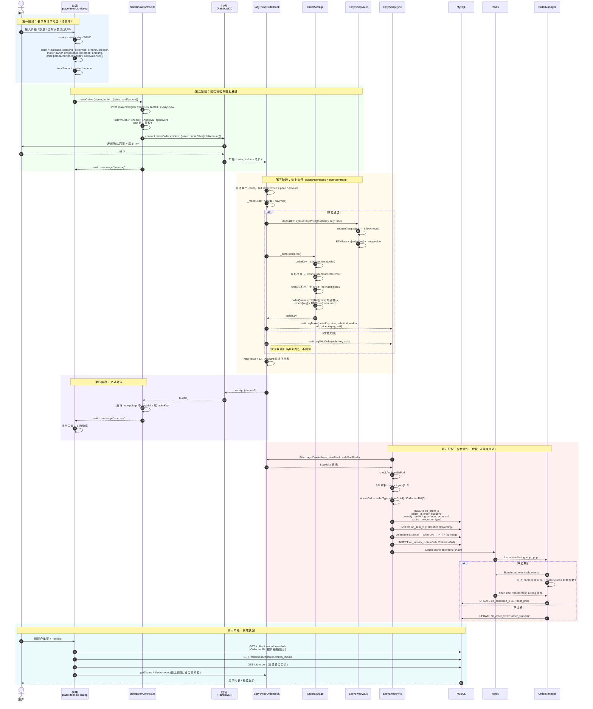
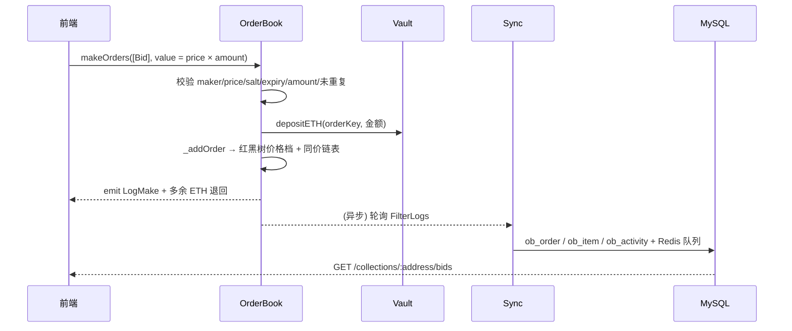

# 挂买单（Bid）关键点与时序

> 代码依据：`EasySwapOrderBook.sol`、`EasySwapVault.sol`、`OrderStorage.sol`、`LibOrder.sol`、
> `nft-market-fe/contracts/service/orderBookContract.ts`、`place-item-bid-dialog.tsx`、`place-bid-dialog.tsx`、
> `EasySwapSync/service/orderbookindexer/service.go`、`EasySwapBase/ordermanager/*`。

---

## 一、挂买单关键点

### 1. 两种买单形态

| 类型 | `side` | `saleKind` | `nft.tokenId` | 业务含义 |
|---|---|---|---|---|
| 单品买单 | `Bid = 1` | `FixedPriceForItem = 1` | 真实 tokenId | 只想买这一张 |
| 集合买单 | `Bid = 1` | `FixedPriceForCollection = 0` | `0`（忽略） | 该合集任意一张都可以 |

对应 DB 的 `order_type`：单品 `ItemBidOrder = 4`，集合 `CollectionBidOrder = 3`。

### 2. 订单字段硬性约束（合约强制）

| 字段 | 约束 | 失败表现 |
|---|---|---|
| `maker` | 必须 `== msg.sender`，不能是零地址 | 不满足则 `emit LogSkipOrder` 跳过（不回滚） |
| `price` | 不能为 0 | 同上，跳过 |
| `salt` | 不能为 0 | 同上，跳过；前端用 `Date.now()` |
| `expiry` | `== 0`（永不过期）或 `> block.timestamp` | 同上，跳过 |
| `nft.amount` | 不能为 0 | 同上，跳过（**List 单则是必须 == 1**） |
| 重复性 | `filledAmount[OrderKey] == 0` | 同内容订单二次提交会被跳过 |

> 注意：这些校验失败是 **skip 不是 revert**，函数返回 `OrderKey[]` 里该位置为 `ORDERKEY_SENTINEL`（`bytes32(0)`）。前端必须检查返回值/事件，不能只看交易成功。

### 3. 锁定金额 = 单价 × 数量

- 前端：`value = totalAmount`（价格 × 数量，ETH 字符串），`makeOrders` 内部 `parseEther(options.value)` 转 wei
- 合约：`buyPrice = Price.unwrap(order.price) * order.nft.amount`，累加成 `ETHAmount`
- 结算：`msg.value > ETHAmount` 退回差额；`msg.value < ETHAmount` 会因 Vault 侧余额不足 revert
- List 单不消耗 `msg.value` 之外的任何东西（只转 NFT）

### 4. 资金路径（三跳）

```
用户钱包 ──msg.value──> EasySwapOrderBook ──depositETH{value}──> EasySwapVault
                                                                    ↓
                                                        ETHBalance[orderKey] += msg.value
```

- **买单不需要 approve NFT**，只有 List 单才走 `approveNFT(vault, tokenId)`
- Vault 按 `OrderKey` 单独记账，撮合/撤单都靠 `buyOrderKey` 定位锁仓资金
- Vault 的 `depositETH` / `withdrawETH` 受 `onlyEasySwapOrderBook` 限制

### 5. OrderKey 决定一切

```solidity
OrderKey = keccak256(abi.encodePacked(
    ORDER_TYPEHASH, side, saleKind, maker, hash(nft), price, expiry, salt
))
```

- OrderKey 同时是：Vault 记账 key、`filledAmount` 的 key、红黑树链表里的订单 ID
- **内容任一字段变化即变成新订单**；反之完全相同的订单会被 `_addOrder` 的 `CannotInsertDuplicateOrder` 拒绝
- 前端想查某单是否已成交，必须用 `computeOrderKey()` 自己复刻这个哈希（不能依赖 EIP-712）

### 6. 订单在合约内的落位

```
priceTrees[collection][Bid]        ← 红黑树，Bid 侧“最高价”是 last()
orderQueues[collection][Bid][price] ← 同价 FIFO 链表（head/tail + next 指针）
orders[orderKey] = DBOrder{order, next}
```

- 取最优买单：`getBestPrice(collection, Bid)` → `tree.last()`
- 展示/撮合候选：`getOrders(collection, tokenId, Bid, saleKind, count, price, cursor)`
- ⚠️ `getBestOrder()` **不过滤 `filledAmount`/`CANCELLED`**，会返回已成交订单

### 7. 状态流转（DB 视角）

```
下单 LogMake     → order_status = 0 (Active)
到期（时间轮）    → order_status = 2 (Expired)
撤单 LogCancel   → order_status = 3 (Cancelled)
被吃单 LogMatch  → quantity_remaining -= 1；归零则 4 (Filled)
```

`quantity_remaining` 初始 = `nft.amount`，集合买单可以分多次成交。

### 8. 前后端可见性有延迟

买单上链 ≠ 立刻出现在列表。链路是：

```
LogMake → Sync 轮询（落后多时 1000 块一批，追平后 8 个确认才索引）
        → 写 ob_order / ob_item / ob_activity
        → Redis 队列 → orderManager
```

前端列表读的是 DB，所以**下单后立刻刷新可能看不到自己的买单**。

### 9. 常见坑（代码级）

| 坑 | 说明 |
|---|---|
| 买单被计入地板价 | `AddToOrderManagerQueue` 对 Bid 单也发 `Listing` 事件，`floorPriceProcess` 会把它塞进最低价队列，语义上买单不该影响 floor price |
| `ob_item` 被 Bid 单写入 | `handleMakeEvent` 对所有 LogMake 都 Create `ob_item`（owner=maker、list_price=price），靠 `OnConflict DoNothing` 兜底 |
| `filledAmount` 双语义 | 既是成交数量，也是取消标记（`type(uint256).max`），已取消订单不能用相同内容重建 |
| `salt` 用毫秒时间戳 | 同一毫秒连挂两单内容相同 → 第二单被跳过 |
| 超额付款静默入账 | Vault `editETH` 分支里 `ETHBalance[new] = msg.value + old`，多传的钱不会退 |
| 集合买单的 tokenId | 传 `0`，但 `_isMatchAvailable` 对集合买单直接放行资产匹配，不校验 tokenId |

---

## 二、挂买单完整时序



---

## 三、时序精简版（面试口述用）



一句话概括：

> 用户在前端构造一张 `Bid` 订单（单价 + 数量 + 过期时间 + 毫秒 salt），带着 `price × amount` 的 ETH 调 `makeOrders`；
> 合约校验通过后把 ETH 经 `depositETH` 锁进 Vault，按 `OrderKey` 插入红黑树价格档与同价 FIFO 链表，并发出 `LogMake`；
> 同步服务轮询到事件后落库 `ob_order` / `ob_item` / `ob_activity`，再交给 `orderManager` 维护过期时间轮与地板价；
> 前端最终通过 REST 读 DB 展示买单，撮合前再用链上 `filledAmount` 做一次兜底校验。

---

## 四、涉及的关键代码位置

| 环节 | 文件 : 符号 |
|---|---|
| 前端入口（单品） | `app/collections/[name]/components/place-item-bid-dialog.tsx : handlePlaceBid` |
| 前端入口（集合） | `app/collections/[name]/components/place-bid-dialog.tsx : handlePlaceBid` |
| 前端封装 | `contracts/service/orderBookContract.ts : makeOrders / makeBid / computeOrderKey` |
| 合约入口 | `EasySwapOrderBook.sol : makeOrders` |
| 订单创建 | `EasySwapOrderBook.sol : _makeOrderTry` |
| 订单落位 | `OrderStorage.sol : _addOrder` |
| 订单哈希 | `LibOrder.sol : hash(Order)` |
| 资产托管 | `EasySwapVault.sol : depositETH / withdrawETH` |
| 事件定义 | `EasySwapOrderBook.sol : event LogMake` |
| 索引写入 | `EasySwapSync/service/orderbookindexer/service.go : handleMakeEvent` |
| 队列与过期 | `EasySwapBase/ordermanager/service.go : ListenNewListingLoop`、`expiredorder.go` |
| 地板价维护 | `EasySwapBase/ordermanager/floorprice.go : floorPriceProcess / checkAndUpdateFloorPrice` |
| 列表查询 | `EasySwapBackend/src/dao/items.go : QueryCollectionBids`、`service/v1/order.go : GetOrderInfos` |
